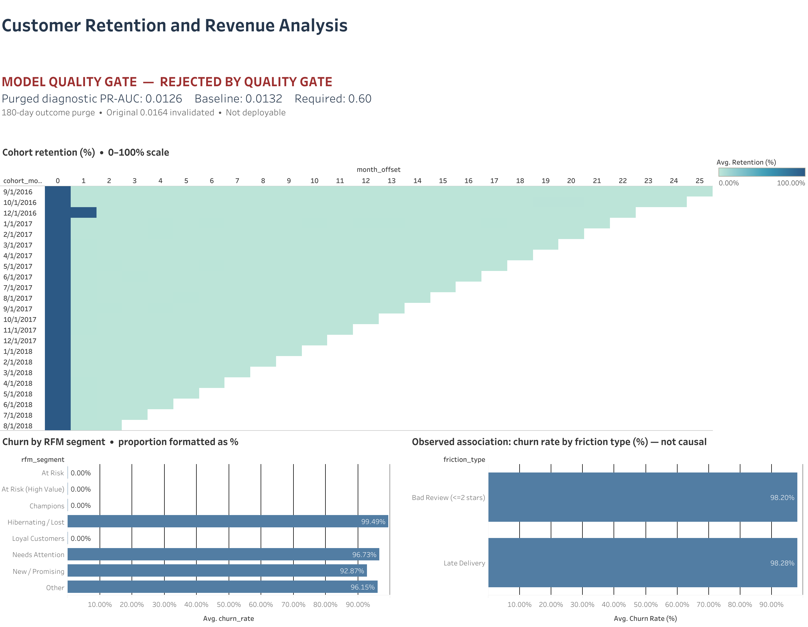

# Olist Customer Retention and Revenue Analysis

A business analysis of repeat purchasing in the Olist e-commerce dataset. The project uses PostgreSQL and Tableau to examine cohort retention, RFM segments, and delivery and review friction. It also includes a reproducible ML pipeline as an evaluated candidate, with data checks, CI, and a Dockerized staging inference service.

> **Recommendation:** Use the descriptive analysis to guide questions and experiments. Do not use the current model for customer targeting: it has not demonstrated predictive lift, and its original temporal evaluation had a label-maturity leakage flaw. After correcting the evaluation with a 180-day purge, the logistic model achieved **0.0126 PR-AUC** against a **0.0132** repeat-customer baseline. This is a diagnostic on the previously examined holdout, not a final deployment estimate. No real-data model is approved for deployment.

## Business question and analysis

**Business question:** What customer and first-order characteristics are associated with a customer placing another delivered order, and how does repeat purchasing vary across cohorts and RFM segments?

The analysis uses a point-in-time definition: score 30 days after a customer's first delivered order, then observe whether they place another delivered order within the next 180 days. Customers who reordered before scoring and customers without a full outcome window are excluded. This is a repeat-purchase propensity problem on a one-time-purchase-heavy marketplace dataset; it is not subscription cancellation.

The dataset has **55,487 eligible customers** and **783 repeat buyers** (about **1.41%**). The rarity of the outcome makes accuracy misleading and leaves relatively few positive examples for training and evaluation.

The project examines:

- Customer purchase sequences, running revenue, and reorder intervals with PostgreSQL window functions and CTEs.
- Monthly acquisition cohorts and RFM customer segments.
- Associations between repeat purchasing and late deliveries or low review scores. These are observational results, not causal estimates.
- A point-in-time repeat-purchase target and an explicit exclusion for customers who already reordered before the scoring date.
- A Tableau dashboard with cohort retention, churn by RFM segment, observed friction associations, and the model evaluation status.

Delivery and review charts are observational. They show where churn is concentrated, but do not show that changing delivery or review outcomes will cause more repeat purchases. The dataset also lacks campaign exposure and treatment outcomes, so it cannot establish which customers would respond to a retention offer.

### Business recommendation

- Use cohort and segment reporting to monitor repeat purchasing and identify areas for follow-up analysis.
- Treat delivery and review findings as hypotheses to investigate, not measured campaign effects.
- Do not target customers with the current model. If retention offers are considered, evaluate them with a controlled experiment and measure incremental repeat purchase and margin.
- Present the ML pipeline as a model evaluation and validation exercise. The evidence currently supports rejecting the model, not claiming successful churn prediction.

## Repository layout

```text
sql/                          Analytics and churn feature queries
migrations/                   PostgreSQL schema and migrations
python/                       Existing analysis, database access, and Tableau exports
src/revenue_analysis/ml.py    Data contract, features, training, drift, and artifacts
src/revenue_analysis/service.py FastAPI staging inference service
tests/                        Pipeline and inference contract tests
.github/workflows/ml.yml      Fixture training, quality gate, and image build
Dockerfile.staging            Staging inference image
model/                        Locally generated model artifacts and evaluation reports
```

## Setup

Requirements: Python 3.14, [`uv`](https://docs.astral.sh/uv/), PostgreSQL 16, and Docker for the staging image.

Install the locked Python environment and run the pipeline checks:

```bash
uv sync --locked
uv run pytest -q
```

Configure the database in the project-root `.env` file using `POSTGRES_USERNAME`, `POSTGRES_PASSWORD`, `POSTGRES_DATABASE`, and optionally `POSTGRES_HOST` and `POSTGRES_PORT`. Start PostgreSQL and apply migrations:

```bash
docker compose up -d postgres
docker compose --profile migrations run --rm dbmate up
```

Load the bundled Olist CSVs from the repository root with `psql`. Export the connection variables from `.env` in your shell, then run the load command:

```bash
set -a
. ./.env
set +a
psql -h "${POSTGRES_HOST:-localhost}" -p "${POSTGRES_PORT:-5432}" \
  -U "$POSTGRES_USERNAME" -d "$POSTGRES_DATABASE" \
  -v ON_ERROR_STOP=1 -f sql/02_load_data.sql
```

The load script uses paths under `data/raw/`; run it from the repository root. The CSVs are included in this repository.

## Build the real feature dataset

`sql/07_churn_features.sql` creates one row per eligible customer. It limits seller history to deliveries before the customer's first purchase and review information to the scoring cutoff. Run the query through the project data-access helper and export the result:

```bash
mkdir -p data/processed
uv run python -c 'import sys; sys.path.insert(0, "python"); from data_access import load_churn_features; df = load_churn_features(); print(f"rows={len(df)}"); df.to_csv("data/processed/churn_features.csv", index=False)'
```

The generated `data/processed/` export is ignored by Git. The current local run completed in 177.8 seconds. Runtime will depend on the database and its available resources.

## Train and evaluate

Train on the synthetic fixture to exercise the pipeline and produce a local artifact:

```bash
uv run revenue-train \
  --data tests/fixtures/churn.csv \
  --output model/fixture \
  --min-pr-auc 0.60
```

Train and evaluate against a real feature export with the same default gate:

```bash
uv run revenue-train \
  --data data/processed/churn_features.csv \
  --output model/real-data \
  --min-pr-auc 0.60
```

The trainer validates input columns and values with Pandera, performs a chronological split on `scoring_date`, fits preprocessing on training rows, and evaluates retained-class average precision. The current CLI split does not yet purge training rows whose 180-day outcome windows extend beyond the holdout start; do not treat its real-data score as a valid prospective estimate. The corrected diagnostic below applies that purge. The gate requires PR-AUC to exceed both the configured floor and holdout retained prevalence by at least 0.05. If it passes, the pipeline refits on all validated rows and writes `model.joblib` plus `report.json`. If it fails, training exits without writing a deployable model.

The report records the dataset and pipeline hashes, split, metrics, configuration, library versions, missing-value rates, drift reference profile, and model checksum. Load artifacts only from trusted training runs; joblib uses Python pickle serialization.

### Real-data evaluation and correction

The initial real-data report used a 75/25 chronological split beginning on 2018-02-12. It reported PR-AUC **0.01641** against **0.01323** prevalence. That split was not a valid forward-in-time simulation: many training labels used outcomes from the 180 days after the simulated test start, which would not have been available when fitting the model.

I re-evaluated the fixed-seed logistic regression after purging training rows whose 180-day label window had not matured by the test start. This left **13,959** training rows, including **228** repeat buyers, and the same previously examined holdout of **13,905** rows, including **184** repeat buyers. The test holdout has already been inspected during this analysis, so this is a corrected diagnostic, not a fresh untouched final estimate.

| Metric | Corrected diagnostic |
| --- | ---: |
| Retained prevalence | 0.01323 |
| Retained PR-AUC | 0.01255 |
| PR-AUC difference from prevalence | -0.00068 |
| Retained ROC-AUC | 0.48744 |
| Configured PR-AUC floor | 0.60 |
| Quality gate | Failed |

Purged diagnostic folds using logistic regression, LightGBM, and XGBoost scored approximately **0.011–0.016 PR-AUC** at about **0.012 prevalence**. None approached the configured 0.60 floor. These experiments do not prove that a better model is impossible, but the current features and labels provide no evidence that the gate is attainable. The correct next step is to define an actionable business decision and an economically justified metric before further model tuning. Do not flip the positive class or lower the gate just to obtain a pass.

The versioned [real-data evaluation report](reports/real-data-evaluation.json) preserves the original run for reproducibility; its **0.01641** score is superseded by the leakage-corrected diagnostic above and must not be presented as a valid prospective estimate. The prior exploratory XGBoost results in `tableau_exports/model_comparison.csv` use a different label/evaluation setup and are not directly comparable.

## Staging inference

The image embeds a model artifact from the `model/` directory. To build it, first train a candidate that passes the gate and writes `model/model.joblib` and `model/report.json`:

```bash
uv run revenue-train \
  --data <approved-feature-export.csv> \
  --output model \
  --min-pr-auc 0.60

docker build -f Dockerfile.staging -t revenue-staging .
docker run --rm -p 8000:8000 revenue-staging
```

A failed real-data run does not create a promotable artifact. The evaluation summary is retained in `reports/real-data-evaluation.json`; the generated feature CSV and local model artifacts remain ignored. The fixture artifact can be used to smoke-test the service, but its predictions are not suitable for business decisions.

- `GET /health` returns service status and model version.
- `POST /predict` accepts `{"records": [{...}]}` with every feature listed in `revenue_analysis.ml.FEATURES`; target and extra fields are rejected. Batches are limited to 1,000 records.
- `GET /docs` provides the interactive API schema.
- Responses include retained probabilities, model version, and per-feature drift diagnostics. Numeric drift uses PSI; categorical drift uses total variation distance. Batches below 30 rows are marked too small for a drift decision.

The Docker image pins inference dependencies to match the versions recorded in the model report. It runs as a non-root user and includes a health check.

## Continuous integration

GitHub Actions runs the tests, trains on the small synthetic fixture with the PR-AUC gate enabled, builds the staging image, and uploads the fixture report. A separate test shuffles the target and verifies that a below-gate model is rejected. CI verifies pipeline behavior; it does not validate real-data model quality.

## Analysis outputs

`tableau_exports/` contains CSV outputs for cohort retention, RFM segmentation, statistical tests, customer features, and other exploratory analyses. The screenshot below previews the corrected Tableau dashboard; download the [packaged workbook](tableau_exports/workbook.twbx) to open and interact with it in Tableau.



The dashboard marks the model as rejected and shows the corrected purged PR-AUC diagnostic. Historical model comparison exports are not comparable to this temporal evaluation.
